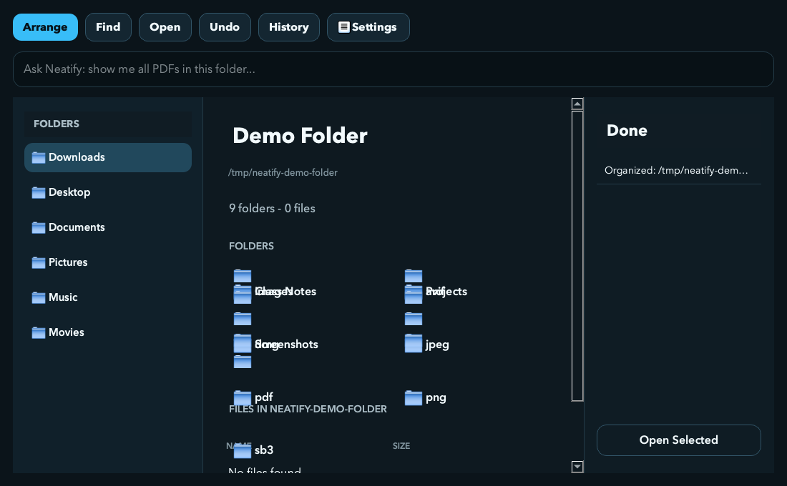
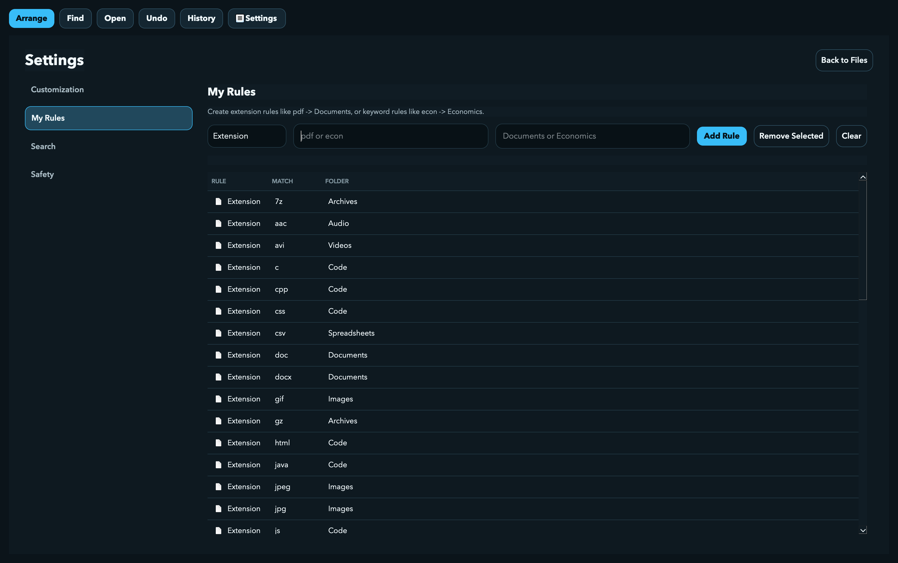
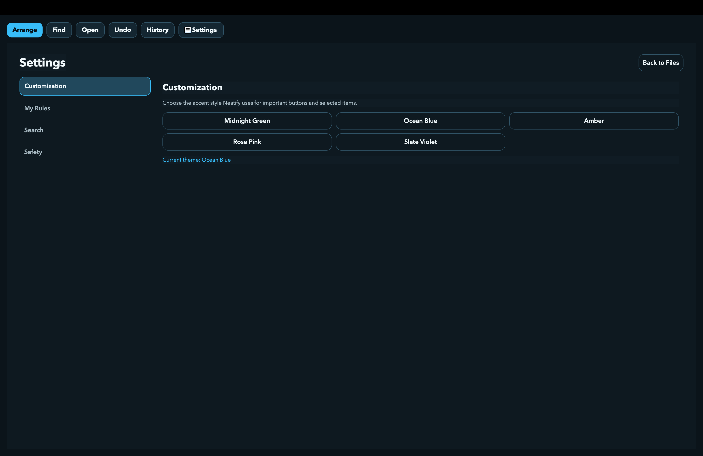
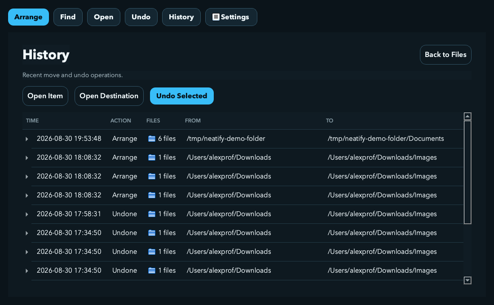
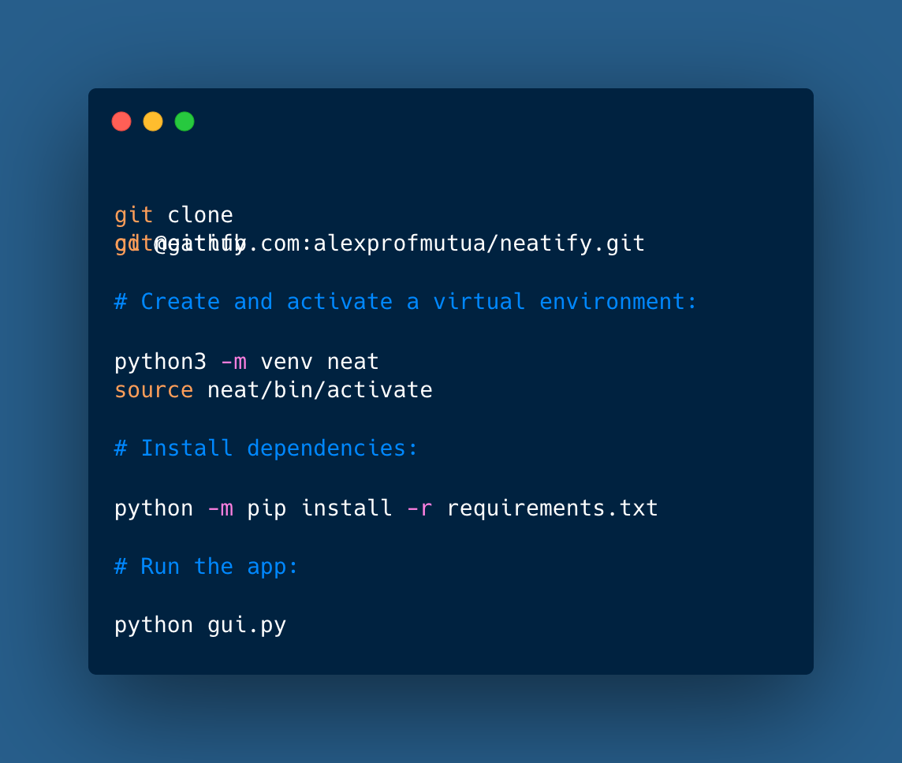
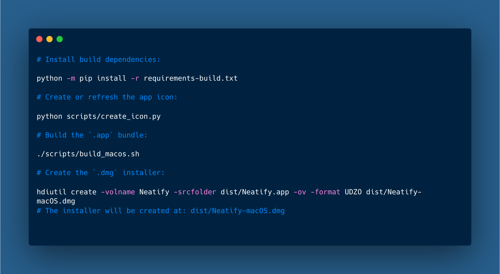

<p align="center">
  
</p>

<p align="center">
  <strong>A safer, smarter way to organize your files.</strong>
</p>

<p align="center">
  <em>Clean your folders without losing control of what happens to your files.</em>
</p>

<p align="center">
  <a href="https://github.com/alexprofmutua/neatify/releases">
    
  </a>
  &nbsp;
  <a href="https://github.com/alexprofmutua/neatify/releases">
    
  </a>
</p>

---

## ✨ Neatify

Neatify is a desktop file organizer I built to help people clean messy folders without losing control of their files.

The project started as a Python command-line script and grew into a PySide6 desktop app with folder browsing, arrange previews, custom rules, filtered search, history, undo, themes, and macOS packaging.


## 💡 Why I Built It

Most file cleanup tools feel risky because they move things immediately and make it hard to understand what changed. Neatify is built around a safer workflow:

```text
choose folder -> preview changes -> proceed or cancel -> record history -> undo if needed
```

I designed Neatify around that workflow so file organization feels inspectable and reversible. The project also gave me a practical way to apply software engineering concepts such as filesystem APIs, GUI architecture, state management, persistence, packaging, and defensive file handling.

## 📌 Current Status

Neatify currently supports macOS development and macOS packaging.

The app can be run from source during development or packaged into a downloadable `.dmg` installer.

## 🖥️ How It Works

1. **Choose a folder** to organize.
2. **Preview the arrange** — see exactly what will move, before anything happens.
3. **Proceed or cancel** the arrange.
4. **History is recorded** for the batch.
5. **Undo** it later if needed.




## 🧩 Highlights

- Finder-style folder browser for common folders.
- External drive detection on macOS.
- Live file and folder listing for the selected location.
- Arrange preview before any file is moved.
- Category-based organization for documents, images, videos, audio, archives, code, spreadsheets, presentations, and uncategorized files.
- Custom extension rules, such as `pdf -> Documents`.
- Custom keyword rules, such as `econ -> Economics`.
- Filtered search across files, folders, extensions, and categories.
- Open selected files or folders directly from the app.
- Move history grouped by arrange batch.
- Multi-select undo for previous arrange batches.
- Duplicate-safe renaming to avoid overwriting files.
- Five visual themes stored in user preferences.
- Packaged macOS `.app` and `.dmg` build flow.





## 🛡️ Safety Model

Neatify is designed to be conservative with files.

- Files are previewed before being moved.
- Files are moved, not deleted.
- Existing destination files are not overwritten.
- Duplicate names are resolved with unique suffixes.
- Move history is recorded by batch.
- Undo checks that files still exist before reversing a move.
- Settings, rules, and history are stored in the app-data folder rather than inside the installed app bundle.



---

## 🚀 Installation

### macOS

Download the latest release from the GitHub Releases page:

```text
https://github.com/alexprofmutua/neatify/releases
```

From the release assets, download:

```text
Neatify-macOS.dmg
```

Then install:

1. Double-click `Neatify-macOS.dmg`.
2. Drag `Neatify.app` into the Applications folder.
3. Open Neatify from Applications.

This early build is not code-signed or notarized yet, so macOS may show a security warning the first time the app opens. If that happens:

1. Open Finder.
2. Go to Applications.
3. Right-click `Neatify.app`.
4. Choose Open.
5. Confirm that you want to open it.

### Windows and Linux

Windows and Linux installers are planned. For now, the app can be run from source on those platforms after installing Python and the project dependencies.

## 🧑‍💻 Developer Setup

Clone the repository and enter the project folder:



## 🏗️ Build for macOS

Install build dependencies:



---

## 🧠 Architecture

I separated Neatify into focused modules instead of keeping all logic in one large file.

```text
neatify/
  gui.py                    # Application entry point
  window.py                 # Main PySide6 window and UI behavior
  style.py                  # Application stylesheet and visual system
  components.py             # Reusable UI helper functions
  state.py                  # Runtime app state
  neatify.py                # Core file operations, history, and undo
  rules.py                  # Custom rules and filtered search
  app_settings.py           # Theme/search preference persistence
  app_paths.py              # Asset paths and per-user data paths
  assets/                   # Logo and icon assets
  scripts/                  # Build automation scripts
```

This structure keeps product UI, file-system behavior, rules, settings, and packaging concerns separate enough to evolve independently.

## 🛠️ Engineering Concepts Demonstrated

- Python application development
- Desktop GUI development with PySide6
- Event-driven programming
- Object-oriented design with shared application state
- File-system traversal and path handling
- Rule-based classification
- Search and filtering
- JSON persistence
- Undo/history design
- Defensive programming around operating-system behavior
- Desktop app packaging with PyInstaller
- macOS DMG distribution workflow

## 🗺️ Roadmap

- Add automated tests for organize, preview, rules, search, and undo.
- Add Windows and Linux packaging.
- Improve public installer polish with code signing and notarization.
- Add a first-run onboarding screen.
- Add optional anonymous download or launch analytics.
- Add AI-assisted commands after user feedback.

## 📄 License

This repository is currently licensed under the MIT License.

Future commercial releases may use a separate proprietary license for distributed builds.

## 👨‍💻 Author

Developed by Alex M.
