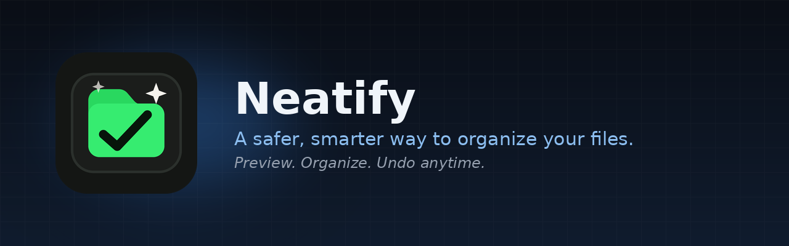
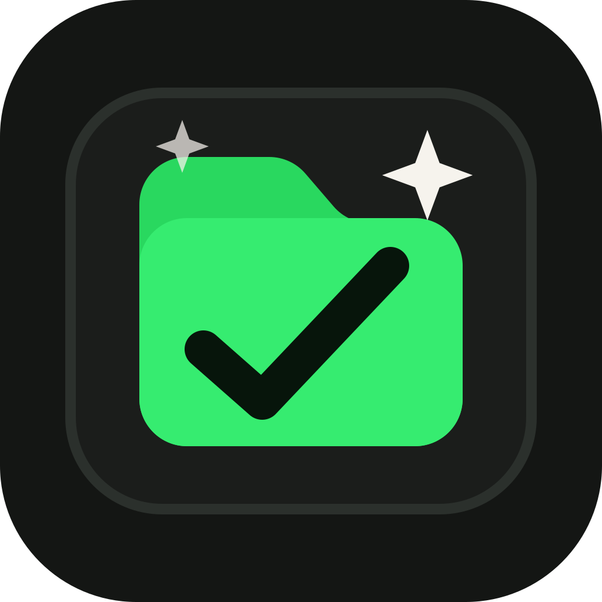
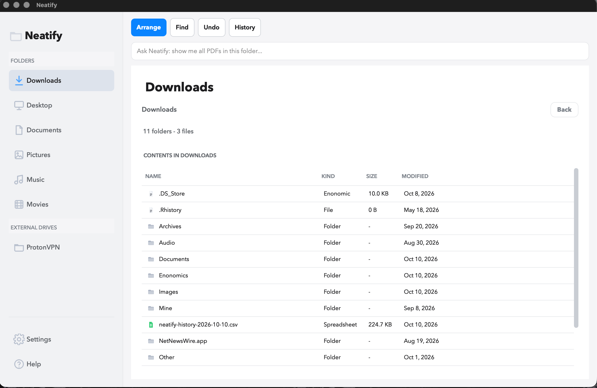
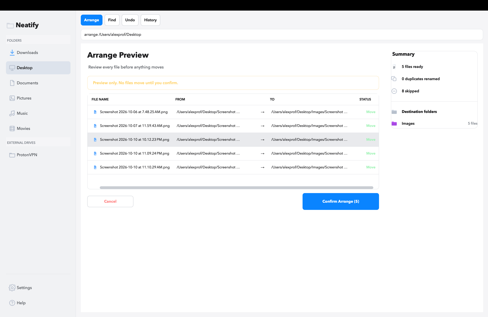
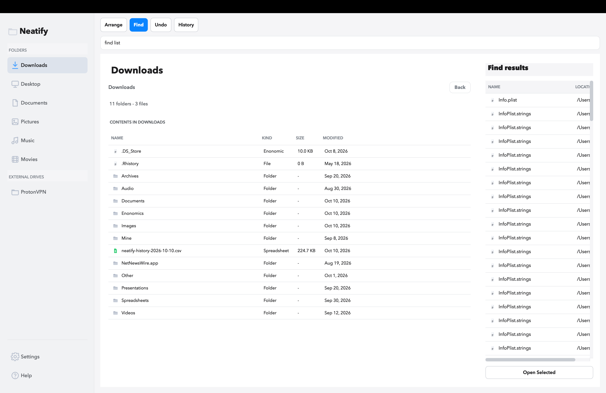
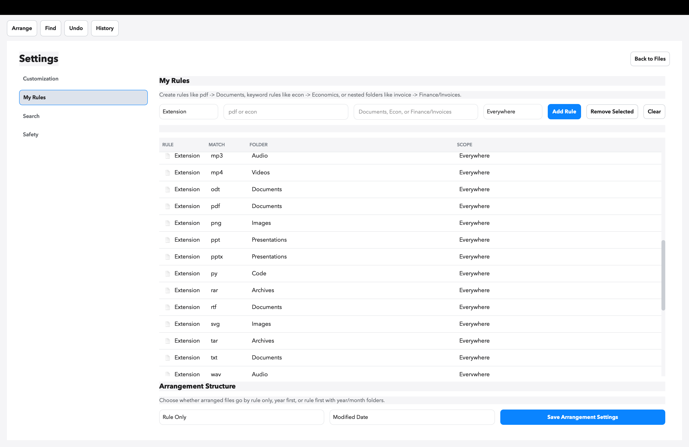

<p align="center">
  
</p>

<p align="center">
  <strong>A safer way to organize messy folders.</strong>
</p>

<p align="center">
  <a href="https://github.com/alexprofmutua/neatify/releases">
    
  </a>
</p>

---

## For Normal Users

Neatify helps you organize files without losing control. It shows a preview before moving anything, handles duplicate names safely, keeps history, and lets you undo previous arrange batches.



### Install

**macOS**

1. Download `Neatify-macOS.dmg` from the Releases page.
2. Open the `.dmg`.
3. Drag `Neatify.app` into Applications.
4. Open Neatify from Applications.

If macOS blocks the app because it is not notarized yet, right-click `Neatify.app`, choose **Open**, then confirm.

**Windows**

1. Download `Neatify-Windows-Setup.exe` from the Releases page.
2. Double-click it.
3. Follow the installer.
4. Open Neatify from the Start menu or desktop shortcut.

If you receive `Neatify-Windows.zip` instead, unzip it and double-click `Neatify.exe`.

### Use

1. Choose a folder from the sidebar.
2. Press **Arrange**.
3. Review the preview.
4. Press **Confirm Arrange** only when it looks right.
5. Use **History** if you need to review, export, or undo a batch.



### Find Files

Press **Find**, type what you want to search for, then press Enter.



### Rules

Open **Settings > My Rules** to teach Neatify where files should go.

By default, Neatify uses a small set of sensible rules:

- Images: `jpg`, `jpeg`, `png`, `gif`, `webp`, `svg`, `heic`
- Documents: `pdf`, `doc`, `docx`, `txt`, `rtf`, `md`
- Spreadsheets: `xls`, `xlsx`, `csv`
- Presentations: `ppt`, `pptx`
- Videos: `mp4`, `mov`, `avi`, `mkv`, `webm`
- Audio: `mp3`, `wav`, `m4a`
- Archives: `zip`, `rar`, `7z`, `tar`, `gz`, `dmg`
- Code: `py`, `js`, `html`, `css`, `java`, `cpp`, `c`, `json`
- Installers: `exe`, `msi`, `pkg`
- Everything else goes to `Other`

Examples:

- `pdf -> Documents`
- `economics -> Econ`
- `invoice -> Finance/Invoices`

You can also choose year and month sorting for larger folders.



### Safety

- Neatify previews before moving files.
- It moves files, not deletes them.
- It renames duplicates instead of overwriting.
- It records arrange history in SQLite.
- It supports undo from History.

---

## For Programmers

Neatify is a Python/PySide6 desktop app.

### Project Structure

```text
neatify/
  gui.py              # App entry point
  window.py           # Main PySide6 window and UI behavior
  style.py            # App styling
  components.py       # Reusable UI helpers
  state.py            # Runtime state
  neatify.py          # File moves, history, undo
  rules.py            # Rules and search
  app_settings.py     # Saved preferences
  app_paths.py        # Asset and user-data paths
  assets/             # Logo, screenshots, icons
  scripts/            # Build scripts
```

### Run From Source

```bash
cd /path/to/neatify
python3 -m venv neat
source neat/bin/activate
pip install -r requirements.txt
python gui.py
```

On Windows:

```powershell
cd C:\path\to\neatify
python -m venv neat
.\neat\Scripts\Activate.ps1
pip install -r requirements.txt
python gui.py
```

### Build macOS Installer

Build on macOS:

```bash
cd /path/to/neatify
source neat/bin/activate
pip install -r requirements-build.txt
bash scripts/build_macos.sh
```

Output:

```text
release/Neatify-macOS.dmg
```

### Build Windows Installer

Build on Windows:

```powershell
cd C:\path\to\neatify
python -m venv neat
.\neat\Scripts\Activate.ps1
pip install -r requirements.txt
pip install -r requirements-build.txt
.\scripts\build_windows.ps1
```

For a one-click installer, install Inno Setup first:

```text
https://jrsoftware.org/isinfo.php
```

Output:

```text
release\Neatify-Windows-Setup.exe
```

Without Inno Setup, the script creates:

```text
release\Neatify-Windows.zip
```

### Release Checklist

Before uploading a release:

1. Run the test suite with `python -m pytest`.
2. Run `python scripts/benchmark_speed.py` and keep the result for release notes.
3. Build macOS on macOS and Windows on Windows.
4. Open the built app and test Arrange, Find, History, Undo, Settings, and custom rules.
5. Upload the installer from the `release/` folder to GitHub Releases.

### Notes

- Settings, rules, and history are saved in the user's app-data folder.
- macOS and Windows builds should be created on their own operating systems.
- The current app is not code-signed or notarized yet.

## License

MIT License.

## Author

Developed by Alex M.
